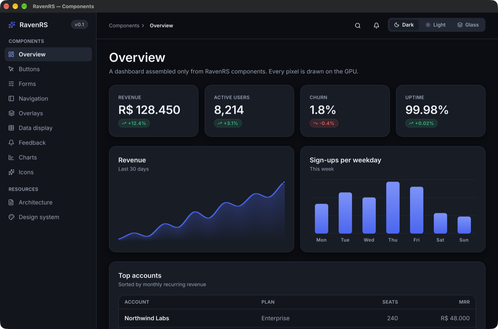
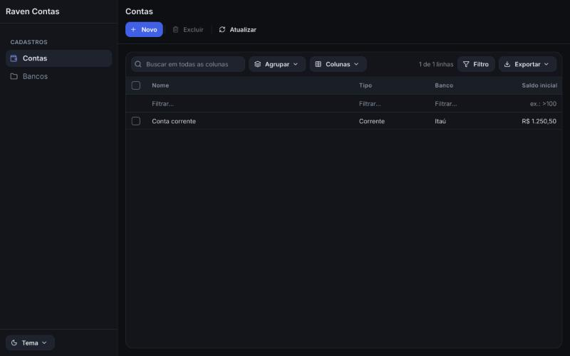
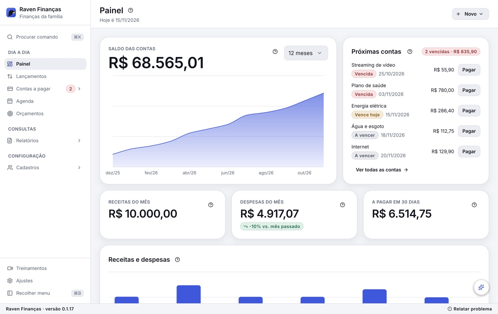
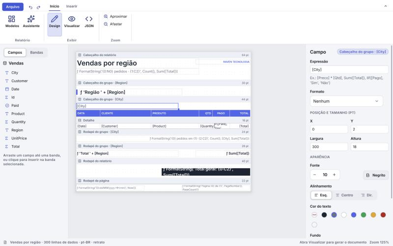

<div align="center">

# RavenRS

**Beautiful native interfaces, powered by Rust.**

The whole toolkit for serious applications, free and open source: 100+ components, a data grid for 100,000+ rows, a reporting suite with a server, `ravenrs-app`, which turns a Rust struct into a working application, training films that ship inside your app, and AI that stays on the machine. One codebase, drawn on the GPU, on Windows, macOS, Linux and the web.

[**Try the live gallery**](https://alexkads.github.io/RavenRS/demo/) · [Playground](https://alexkads.github.io/RavenRS/playground/) · [Report designer](https://alexkads.github.io/RavenRS/designer/) · [Install a real app](#install-a-real-app) · [An app from two structs](https://alexkads.github.io/RavenRS/quick/) · [Getting started](https://github.com/alexkads/RavenRS/blob/master/docs/GETTING_STARTED.md) · [Components](https://alexkads.github.io/RavenRS/components/) · [API docs](https://alexkads.github.io/RavenRS/api/ravenrs/)




</div>

## What you get

Building a business application usually means assembling a UI kit, a commercial grid, a reporting product and a stack of custom screens. RavenRS is all of it, in one language, under one license.

| | | |
|---|---|---|
| **[`ravenrs-app`](#ravenrs-app-declare-a-record-get-the-application)** | Declare a Rust struct and get the application: navigation, lists, forms, rules, security and an audit trail | [Generated app](https://alexkads.github.io/RavenRS/quick/) |
| **[Raven Finanças](#install-a-real-app)** | A complete family finance app, built with all of this, to install on your computer | [Install](#install-a-real-app) |
| **[Components](#components)** | 100+ designed, tested components: ribbon, scheduler, command palette, charts, forms, wizards, 200 icons | [Gallery](https://alexkads.github.io/RavenRS/demo/) |
| **[DataGrid](#a-data-grid-for-real-data)** | 100,000+ rows at 2 ms a frame, grouping, summaries, editing, master-detail, Excel and PDF | [Gallery](https://alexkads.github.io/RavenRS/demo/) |
| **[Reporting](#reporting-from-designer-to-inbox)** | Engine, end-user designer, viewer, PDF and XLSX, and a server that emails reports on a schedule | [Designer](https://alexkads.github.io/RavenRS/designer/) |
| **[Training films](#training-that-ships-inside-your-app)** | Vector films of your real app that weigh kilobytes, re-recorded by a script when screens change | [`ravenrs-movie`](https://github.com/alexkads/RavenRS/blob/master/crates/ravenrs-movie) |
| **[Local AI](#ai-that-stays-on-the-machine)** | Models that run on the CPU in plain Rust, with nothing sent anywhere | [`ravenrs-ai`](https://github.com/alexkads/RavenRS/blob/master/crates/ravenrs-ai) |

## `ravenrs-app`: declare a record, get the application

The newest and biggest part of RavenRS. The screens most business software spends its budget on come from a Rust struct, and you write only what makes your application different:

```rust,ignore
use ravenrs_app::BusinessObject;
use ravenrs_app_ui::App;

#[derive(BusinessObject)]
#[object(caption = "Accounts", navigation = "Records", icon = "wallet")]
#[rule(criteria = "[opening] >= 0", message = "An account cannot open negative")]
struct Account {
    #[field(key)]
    id: i64,
    #[field(caption = "Name", default_property, required)]
    name: String,
    #[field(caption = "Opening balance", money)]
    opening: i64,
}

fn main() -> Result<(), ravenrs::native::PlatformError> {
    let window = App::new("Accounts").entity::<Account>().into_view();
    ravenrs::native::run(window, ravenrs::native::WindowOptions::new("Accounts"))
}
```

That is the whole application: navigation, a list with search, filters and export to Excel, PDF and CSV, a form, and every command from New to Save and close. A wrong attribute is a compile error that points at it. [See one running in your browser](https://alexkads.github.io/RavenRS/quick/), generated from two structs:



From there it grows with you:

- **Rules and logic:** validation of every kind, warnings that let people go on, conditional appearance, state machines, reminders, actions and controllers.
- **Security:** sign-in with lockout, roles and permissions on entities, records, fields, navigation and actions, enforced in the data layer even with no screen, and a full audit trail.
- **Data:** SQLite on a schema it manages or on tables you already have, migrations, relations, attachments, and concurrent changes that merge.
- **Views:** dashboards, charts, trees, calendars and timelines over a list, and reports your users design and keep as records.
- **Customization at run time:** a model in layers, so a module, an administrator or a user can change the application as a JSON difference, and even add fields.

Status: usable today, with the API still moving, and shipped as separate crates: `cargo add ravenrs ravenrs-app ravenrs-app-ui`. See [docs/APP-FRAMEWORK.md](https://github.com/alexkads/RavenRS/blob/master/docs/APP-FRAMEWORK.md), and run `cargo run -p feature-center` for a demonstration of every feature.

## Install a real app

Want to see what all of this adds up to? [Raven Finanças](https://github.com/alexkads/RavenRS/blob/master/examples/family-finance) is a complete desktop app for a family's expenses and bills to pay, built with RavenRS and free to install on your own computer. Its interface is in Brazilian Portuguese, and it opens on a sample family, so there is something to explore right away.



- **Your data stays with you**, in one SQLite file on your computer, with backups and reports you can export.
- **A real workout for the framework:** dashboard, `DataGrid`, scheduler, budgets, reports, command palette and generated forms in everyday use.
- **Six training films inside the app**, about 16 minutes in all at about 700 KB, and a question opens the moment that answers it.
- **An optional local AI assistant** that answers about your money and prepares entries, with nothing leaving the machine.

The installer compiles the app on your machine and gets what it needs first, Rust and a C compiler, so the first run can take a while. It asks for an administrator's permission only to install those tools, and the app then keeps itself up to date.

On macOS and Linux, in a terminal:

```bash
curl -fsSL https://raw.githubusercontent.com/alexkads/RavenRS/master/examples/family-finance/install.cmd -o /tmp/install.cmd && sh /tmp/install.cmd
```

On Windows 11, in PowerShell:

```powershell
irm https://raw.githubusercontent.com/alexkads/RavenRS/master/examples/family-finance/install.cmd -OutFile "$env:TEMP\install.cmd"; & "$env:TEMP\install.cmd"
```

Already have the repository? `cargo run -p family-finance` runs it without installing. The [app's README](https://github.com/alexkads/RavenRS/blob/master/examples/family-finance) shows which component each screen uses.

## Why RavenRS

- **One UI, every platform.** Desktop windows and a browser `<canvas>` share the renderer, the layout engine and every component. No webview, no DOM widgets, and the same pixels everywhere.
- **Fast, and quiet when idle.** A form with 40 cards takes 1.6 ms a frame, against a 16.7 ms budget at 60 Hz. `State<T>` knows who reads it, so a change redraws only what depends on it, and an idle app uses no CPU or GPU.
- **Finished by default.** Three themes (Raven Dark, Raven Light, Raven Glass) built from semantic design tokens, with text contrast checked against WCAG AA in the test suite. `ThemeEditor` changes any token live and copies the result as JSON.
- **Accessible.** Keyboard operation follows the WAI-ARIA patterns, and screen readers get a real tree: AccessKit on the desktop, an ARIA mirror on the web. The gallery's test suite fails on any unnamed control.
- **Built to be extended.** Your components use the same public API as the built-in ones, from a simple `Component` to a fully custom `View` that draws, scrolls, opens overlays and handles input.
- **Ready for coding assistants.** A skill and an offline MCP server let them write against the real API instead of guessing it.

## Quick start

Add RavenRS from [crates.io](https://crates.io/crates/ravenrs):

```bash
cargo add ravenrs
```

Write your UI:

```rust,no_run
use ravenrs::prelude::*;

fn app() -> impl View {
    let count = State::new(0);
    let increment = count.clone();

    VStack::new((
        Text::new("Welcome to RavenRS").style(TextStyle::Display),
        Card::new(VStack::new((
            Text::new("REVENUE").style(TextStyle::Caption).foreground(Semantic::InkMuted),
            Text::new("R$ 128.450").style(TextStyle::Metric),
            Text::bound(&count, |n| format!("Clicked {n} times")).foreground(Semantic::InkMuted),
        ))),
        Button::new("Get Started").icon(IconName::Sparkles).on_click(move || increment.update(|n| *n += 1)),
    ))
    .spacing(24.0)
    .padding(32.0)
}

fn main() -> Result<(), ravenrs::native::PlatformError> {
    ravenrs::native::run(app(), ravenrs::native::WindowOptions::new("Hello"))
}
```

The [getting started guide](https://github.com/alexkads/RavenRS/blob/master/docs/GETTING_STARTED.md) covers the browser build, state, components of your own, themes and the data grid.

## A data grid for real data

`DataGrid` draws a frame over 100,000 rows in 2 ms. Measured on an Apple M-series laptop, every operation people wait for stays inside one 60 Hz frame:

| Over 100,000 rows | Measured |
|---|---|
| Filter by a range | 0.9 ms |
| Search across columns | 3.2 ms |
| Sort by a number | 7.9 ms |
| Filter by an expression over three conditions | 8.6 ms |
| Group with summaries | 11.3 ms |

- **Find:** multi-column sort, filter row with operators and expressions such as `[Seats] > 10 And [Country] = 'Brazil'`, checklists of values, a visual filter builder, search across columns.
- **Organize:** nested grouping by dragging headers, group and footer summaries with formulas, columns that reorder, resize and pin, master-detail rows, saved layouts and named scenarios.
- **Edit:** typed cell editing with edits that can be refused, adding and deleting rows, buttons on rows, any view as a cell template.
- **Scale and ship:** rows from a server with bounded memory, paging or infinite scroll, and export to Excel, PDF and CSV with real numbers and dates.

## Reporting, from designer to inbox

A complete reporting suite in Rust, on the desktop, in the browser and on servers. [Open the designer in your browser](https://alexkads.github.io/RavenRS/designer/) and build a report without installing anything.



- **Engine:** banded reports with nested groups, master-detail, summaries, expressions, parameters, conditional formatting, charts, barcodes and watermarks. A report is a JSON document, so it can live in git or a database, and be written by code. A grouped report of 10,000 rows and 305 pages lays out in 80 ms.
- **Designer:** a wizard, a ribbon, drag and drop, a field list, a live preview and undo, ready to embed in your own app for your users.
- **Viewer:** page navigation, zoom, thumbnails, text search and a parameter panel.
- **Export:** vector PDF with embedded font subsets and selectable text, XLSX with real numbers and dates, CSV and SVG, all in pure Rust.
- **Server:** [`ravenrs-report-server`](https://github.com/alexkads/RavenRS/blob/master/docs/REPORT-SERVER.md) stores layouts with versions, renders over HTTP, and delivers scheduled reports by email or to a folder, with cron schedules, time zones, retries and a history of every run.

See [docs/REPORTING.md](https://github.com/alexkads/RavenRS/blob/master/docs/REPORTING.md). The expressions come from [`ravenrs-criteria`](https://github.com/alexkads/RavenRS/blob/master/crates/ravenrs-criteria), one language that filters a grid, totals a report, guards a rule or becomes a parameterized SQL `WHERE`.

## Training that ships inside your app

`ravenrs::movie` makes a film of your app with no pixels in it. It stores what the app drew, so it stays sharp at any zoom, and a minute costs kilobytes instead of megabytes.

- **Recorded by a script.** It runs the real app, needs no GPU, and clicks by the names screen readers see. When the screens change, run it again.
- **Edited on a timeline.** Cuts, speed, callouts, captions, spotlight and zoom in `MovieEditor`, all non-destructive.
- **Interactive.** `MoviePlayer` has chapters and steps that wait for the viewer's click, with sounds and voice computed at play time.
- **Answers questions.** `MovieAssistant` and `MovieChat` open the film at the moment that answers what someone asked.
- **Reports bugs that show what happened.** `FlightRecorder` and `BugReporter` keep the recent past of the app the same way.

## AI that stays on the machine

[`ravenrs-ai`](https://github.com/alexkads/RavenRS/blob/master/crates/ravenrs-ai) runs models on the CPU with plain Rust, so building your app still needs nothing but Cargo, and what people ask never leaves their computer.

- **Offers only what fits.** `ModelManager` checks memory and disk, then downloads with progress and verified hashes. The catalog has LFM3, Gemma 3, Qwen, Llama 3.2, Phi-3 and Mistral, from 0.4 to 5 GB.
- **Takes actions safely.** A model can choose among your app's tools, but your code reads the data and does the work, so it never makes up a number.
- **Speaks.** A local voice model gives assistants a voice and narrates training films.

`Chat`, `ModelPicker` and `FloatingPanel` put it on screen. Local models run on the desktop, not in the browser.

## Components

| Group | Components |
|---|---|
| Buttons and commands | `Button` (4 styles, 3 sizes, icons, loading, selected), `IconButton`, `ToggleButton`, `ToggleGroup`, `ButtonGroup`, `SplitButton`, `SegmentedControl`, `Toolbar`, `FloatingToolbar`, `ThemePicker`, `ThemeEditor`, `ThemeSwitcher` |
| Text and choices | `TextField`, `TextArea`, `CodeEditor`, `Playground`, `NumberField`, `MaskedField`, `InputOtp`, `Select`, `Combobox`, `LookupField`, `TagBox`, `Checkbox`, `RadioGroup`, `Toggle`, `Slider`, `ValueSlider`, `InlineRename`, `Stepper`, `Rating`, `FavoriteToggle`, `ColorPicker`, `ColorSwatch`, `SwatchGrid`, `ColorPair`, `NinePointAnchor`, `FileUpload`, `DropZone`, `ImageField` |
| Forms | `FormField` with `validate::{required, email, min_length}` and custom rules, `FormLayout`, `FilterBuilder`, `Wizard`, `StepIndicator`, `StepBadge`, `Label`, `HelpTip` |
| Dates and scheduling | `Calendar`, `DatePicker`, `DateRangePicker`, `TimePicker`, `DateTimePicker`, `YearView`, `EventCalendar`, `Scheduler` (a timeline per resource), `RecurrenceEditor`, `Timeline` |
| Navigation | `Ribbon`, `Menubar`, `Tabs`, `DocumentTabs`, `Sidebar`, `SidebarBrand`, `Breadcrumb`, `Pagination`, `Disclosure`, `Collapse`, `Accordion`, `CommandPalette` (⌘K) |
| Overlays | `Dialog`, `ConfirmDialog`, `Sheet`, `FloatingPanel`, `SplashScreen`, `Popover`, `HoverCard`, `Tooltip`, `DropdownMenu`, `ContextMenu`, `Toaster` |
| Data | `DataGrid`, `TreeView`, `CardView`, `Table`, `List`, `VirtualList`, `SortableList`, `FileBrowser`, `Stat`, `Barcode` (QR Code and linear codes) |
| Charts | `Chart` (line, area, bar, pie, doughnut, radar, radial, scatter, sparkline, candlestick), `ChartCard`, `ChartReference`, `SankeyChart`, `BarChart`, `AreaChart`: all 70 patterns of the shadcn/ui chart catalog are in the gallery |
| Layout | `TileLayout`, `VStack`, `HStack`, `Grid`, `ScrollView`, `Sticky`, `ScrollScene`, `ScrollLinked`, `Anchor`, `Ticker`, `Link`, `QuadField`, `ScrollEdgeArrow`, `Splitter`, `SplitPanes`, `SplitHandle`, `DockArea`, `Card`, `GlassCard`, `Section`, `AspectRatio`, `ZStack`, `PropertyRow`, `PageHeader`, `Spacer`, `Footer`, `StatusBar`, `TitleBar`, `ToolRail`, `responsive`, and `.padding()`, `.background()`, `.frame()`, `.grow()` on any view |
| Media and feedback | `Image` (PNG/JPEG), `Icon` (200 Lucide icons), `Filmstrip`, `PagedDocumentView`, `ImageLightbox`, `CompareView`, `Eyedropper`, `CropOverlay`, `Protractor`, `TransformHandles`, `Marquee`, `RubberBand`, `RuleOfThirdsGrid`, `Minimap`, `ZoomPanView`, `ZoomControl`, `CurveEditor`, `ColorWheel`, `Ruler`, `Histogram`, `Carousel`, `Avatar`, `Badge`, `Dot`, `OverlayBadge`, `IconTile`, `EmptyState`, `Alert`, `HeroBanner`, `ProgressBar`, `MultiProgress`, `ShimmerText`, `Spinner`, `Skeleton`, `Kbd`, `ShortcutSheet`, `ShortcutHintBar`, `Divider`, `DaySeparator`, `Canvas`, `CodeBlock`, `ReleaseNotes`, `Lottie` |
| Assistants | `Chat`, `RichText`, `AttachmentStrip`, `AudioPlayerButton`, `SelectionBar`, `ModelPicker` |
| Training and support (`ravenrs::movie`) | `Recorder`, `MoviePlayer`, `MovieAssistant`, `MovieChat`, `MovieEditor`, `FlightRecorder`, `BugReporter` |

Every component is in [`examples/component-gallery`](https://github.com/alexkads/RavenRS/blob/master/examples/component-gallery), which runs natively and [in your browser](https://alexkads.github.io/RavenRS/demo/). For a whole app, [install Raven Finanças](#install-a-real-app).

## Your own components

```rust,no_run
use ravenrs::prelude::*;

/// State lives in the struct; `body` composes views and runs on every rebuild.
struct Counter {
    count: State<i32>,
}

impl Component for Counter {
    fn body(&self) -> impl View {
        let count = self.count.clone();
        HStack::new((
            Text::bound(&self.count, |c| format!("{c}")).style(TextStyle::Title),
            Button::new("+1").on_click(move || count.update(|c| *c += 1)),
        ))
    }
}
```

Need full control? Implement `View` and use `BuildCx`: layout boxes, any drawing through `Paint::Custom`, per-instance state with `cx.use_state`, floating layers with `cx.overlay`, virtualized scrolling, timers with `cx.wake_at`, and input through `on_click`, `on_key`, `on_drag`, `on_context_menu` and `shortcut`. Every built-in component is written this way.

## Getting started

```bash
npx create-ravenrs minha-loja
```

The guided setup prepares Rust and the matching CLI, then creates an app with the RavenRS
MCP server, skill and instructions for coding assistants. Choose `hello`, `app`, `app-sqlite`
or `relatorios`, and desktop, web or both. Use `--yes` for noninteractive setup. Existing
installations are reused and system packages are reported with manual instructions.
See [create-ravenrs](npm/create-ravenrs/README.md).

If Rust is already installed:

```sh
cargo install --git https://github.com/alexkads/RavenRS --locked cargo-ravenrs
cargo ravenrs new minha-loja
```

Use `--tag vYY.R.P` when installing to match a particular release.
See [the CLI guide](crates/cargo-ravenrs/README.md).


## Run the examples

Requirements: Rust stable 1.88+. For the browser: the `wasm32-unknown-unknown` target and `wasm-bindgen-cli` **0.2.130** (it must match the crate version).

```bash
cargo run -p component-gallery --release
```

```bash
rustup target add wasm32-unknown-unknown
```

```bash
cargo install wasm-bindgen-cli --version 0.2.130 --locked
```

```bash
./scripts/build-web.sh component-gallery && python3 -m http.server -d examples/component-gallery/web 8080
```

Then open http://localhost:8080 in a current browser. RavenRS draws with WebGPU where the browser has it and with WebGL2 otherwise, so it also opens on phones and browsers without WebGPU; `WebOptions::backend` can ask for one of them.

## Quality you can check

- **More than 1,400 tests**, including accessibility audits, property tests, and GPU golden images in dark and light.
- **Performance budgets** with published numbers, kept by benchmarks: see [docs/QUALITY.md](https://github.com/alexkads/RavenRS/blob/master/docs/QUALITY.md).
- **Small enough for the web:** a hello-world is about 1.2 MB gzipped, and the whole gallery with every chart about 1.5 MB.
- **Almost no `unsafe`:** one call in the workspace, for touchpad pinches on Wayland.
- **An open scorecard:** [docs/PARITY.md](https://github.com/alexkads/RavenRS/blob/master/docs/PARITY.md) tracks 113 component families of shadcn/ui and two commercial component suites: 72 done, 7 partial and 34 planned, with what is missing named row by row. [docs/REPORTING-PARITY.md](https://github.com/alexkads/RavenRS/blob/master/docs/REPORTING-PARITY.md) and [docs/APP-PARITY.md](https://github.com/alexkads/RavenRS/blob/master/docs/APP-PARITY.md) do the same for reporting and the application framework.

**Versions** follow the component-vendor model, `YY.R.P`, with new features in `.2` and monthly fixes. Until 28.1.0 any release may hold breaking changes, so pin an exact version if that matters to you; from then on they come only in each year's `.1` ([docs/VERSIONING.md](https://github.com/alexkads/RavenRS/blob/master/docs/VERSIONING.md)).

## AI assistants

RavenRS ships a skill and an MCP server so coding assistants write against the real API instead of guessing it.

- The **skill** teaches how to compose screens, use tokens instead of literal values, meet the [quality bar](https://github.com/alexkads/RavenRS/blob/master/docs/QUALITY.md) and build for the web.
- The **MCP server** ([`ravenrs-mcp`](https://github.com/alexkads/RavenRS/blob/master/crates/ravenrs-mcp)) is read-only and works offline. It lists components, shows their API and real examples, looks up design tokens, reports parity status and validates expressions.

`cargo ravenrs new` registers `cargo ravenrs mcp` for Claude Code, VS Code / Copilot,
Cursor and Codex, copies the version-matched skill, and writes project instructions.
For an existing app, run `cargo ravenrs ai`, then `cargo ravenrs doctor` to verify it.
Use `--plugin` to select the versioned Claude marketplace plugin instead of the local skill.

Whoever writes the code, a person or any agent, [`ravenrs-lint`](https://github.com/alexkads/RavenRS/blob/master/crates/ravenrs-lint) holds it to the same rules: it denies literal colors and sizes, spacing off the grid, unnamed icon buttons and state or blocking work in `body`, and `cargo ravenrs-lint --init` turns rustc and Clippy to their strictest and writes the rules into `AGENTS.md`, `CLAUDE.md`, `GEMINI.md` and Copilot's instructions.

```bash
cargo install ravenrs-lint --locked && cargo ravenrs-lint --init
```

## Crates

Start with `ravenrs`. The others come in as you need them.

| Crate | What it does |
|---|---|
| [`ravenrs`](https://github.com/alexkads/RavenRS/blob/master/crates/ravenrs) | The facade and `prelude`, with components, windows, the web and films. Start here. |
| [`ravenrs-report`](https://github.com/alexkads/RavenRS/blob/master/crates/ravenrs-report), [`-viewer`](https://github.com/alexkads/RavenRS/blob/master/crates/ravenrs-report-viewer), [`-designer`](https://github.com/alexkads/RavenRS/blob/master/crates/ravenrs-report-designer) | The report engine, the document viewer and the designer. |
| [`ravenrs-report-export`](https://github.com/alexkads/RavenRS/blob/master/crates/ravenrs-report-export), [`-pdf`](https://github.com/alexkads/RavenRS/blob/master/crates/ravenrs-report-pdf), [`-xlsx`](https://github.com/alexkads/RavenRS/blob/master/crates/ravenrs-report-xlsx) | Reports as files. |
| [`ravenrs-report-server`](https://github.com/alexkads/RavenRS/blob/master/crates/ravenrs-report-server) | Layouts, rendering over HTTP and scheduled delivery. |
| [`ravenrs-spreadsheet`](https://github.com/alexkads/RavenRS/blob/master/crates/ravenrs-spreadsheet), [`ravenrs-sheet`](https://github.com/alexkads/RavenRS/blob/master/crates/ravenrs-sheet) | A spreadsheet component and its engine: formulas, recalculation, `.xlsx` in and out. |
| [`ravenrs-grid-export`](https://github.com/alexkads/RavenRS/blob/master/crates/ravenrs-grid-export) | What a `DataGrid` shows, as Excel, PDF or CSV. |
| [`ravenrs-app`](https://github.com/alexkads/RavenRS/blob/master/crates/ravenrs-app), [`-derive`](https://github.com/alexkads/RavenRS/blob/master/crates/ravenrs-app-derive), [`-ui`](https://github.com/alexkads/RavenRS/blob/master/crates/ravenrs-app-ui) | The application framework: model, attributes and generated screens. |
| [`ravenrs-app-i18n`](https://github.com/alexkads/RavenRS/blob/master/crates/ravenrs-app-i18n) | Languages and words of the screens and components, by key, with English to fall back on. |
| [`ravenrs-app-sqlite`](https://github.com/alexkads/RavenRS/blob/master/crates/ravenrs-app-sqlite), [`-report`](https://github.com/alexkads/RavenRS/blob/master/crates/ravenrs-app-report), [`-library`](https://github.com/alexkads/RavenRS/blob/master/crates/ravenrs-app-library) | Storage, reports inside an application, and ready-made records. |
| [`ravenrs-ai`](https://github.com/alexkads/RavenRS/blob/master/crates/ravenrs-ai) | Local models and voice. |
| [`ravenrs-movie`](https://github.com/alexkads/RavenRS/blob/master/crates/ravenrs-movie) | Vector training films and bug reports. |
| [`ravenrs-criteria`](https://github.com/alexkads/RavenRS/blob/master/crates/ravenrs-criteria) | The expression language, independent of any UI. |
| [`ravenrs-graphics`](https://github.com/alexkads/RavenRS/blob/master/crates/ravenrs-graphics) | Vector shapes, chart layout and barcodes, shared by every engine. |
| [`ravenrs-lottie`](https://github.com/alexkads/RavenRS/blob/master/crates/ravenrs-lottie) | A Lottie player of our own: reads the file and works out each frame's curves. |
| [`ravenrs-widgets`](https://github.com/alexkads/RavenRS/blob/master/crates/ravenrs-widgets) | Every component, the `View`/`Component`/`BuildCx` API and the `Ui` runtime. |
| [`ravenrs-reactive`](https://github.com/alexkads/RavenRS/blob/master/crates/ravenrs-reactive) | `State`, `Binding`, `Derived` and dependency-tracking observers. |
| [`ravenrs-animation`](https://github.com/alexkads/RavenRS/blob/master/crates/ravenrs-animation) | Springs, easing and transitions. |
| [`ravenrs-style`](https://github.com/alexkads/RavenRS/blob/master/crates/ravenrs-style) | Design tokens and the Raven Dark, Light and Glass themes. |
| [`ravenrs-layout`](https://github.com/alexkads/RavenRS/blob/master/crates/ravenrs-layout) | Flexbox and grid layout on [Taffy](https://github.com/DioxusLabs/taffy). |
| [`ravenrs-text`](https://github.com/alexkads/RavenRS/blob/master/crates/ravenrs-text) | Text with [Parley](https://github.com/linebender/parley); Inter and the icon font embedded. |
| [`ravenrs-render`](https://github.com/alexkads/RavenRS/blob/master/crates/ravenrs-render) | The `wgpu` renderer: SDF shapes, shadows, gradients, images, glyph atlas, clipping. |
| [`ravenrs-core`](https://github.com/alexkads/RavenRS/blob/master/crates/ravenrs-core) | Geometry, colors, input events and the `Scene` display list. |
| [`ravenrs-platform-native`](https://github.com/alexkads/RavenRS/blob/master/crates/ravenrs-platform-native) | Desktop windows with [winit](https://github.com/rust-windowing/winit). |
| [`ravenrs-platform-web`](https://github.com/alexkads/RavenRS/blob/master/crates/ravenrs-platform-web) | `<canvas>` + WebGPU or WebGL2 in the browser. |
| [`ravenrs-wayland-gestures`](https://github.com/alexkads/RavenRS/blob/master/crates/ravenrs-wayland-gestures) | Touchpad pinches on Wayland. |
| [`ravenrs-mcp`](https://github.com/alexkads/RavenRS/blob/master/crates/ravenrs-mcp) | A read-only MCP server for coding assistants. A tool, not a dependency of your app. |
| [`ravenrs-lint`](https://github.com/alexkads/RavenRS/blob/master/crates/ravenrs-lint) | Lints for applications: theme tokens, the 4px grid, named controls, no state or blocking work in `body`. A dev-dependency and `cargo ravenrs-lint`. |

## Roadmap

RavenRS moves fast, and these are the known gaps.

- **Components:** pivot grid, floating windows, rich text and spreadsheet editors.
- **DataGrid:** multi-level headers, columns pinned to the right, row drag and drop, cell range copy.
- **Reporting:** subreports, a table of contents, cross tabs, and DOCX, HTML and PNG export.
- **Application framework:** a web API, other databases, multi-tenancy, a command-line tool for new projects.
- **Platform:** IME composition display on the desktop, right-to-left layout, multiple windows, backdrop blur for Raven Glass.
- **Motion:** rotation and true group opacity, which need transforms and layers in the renderer.

See [docs/PARITY.md](https://github.com/alexkads/RavenRS/blob/master/docs/PARITY.md) for the full list and [CHANGELOG.md](https://github.com/alexkads/RavenRS/blob/master/CHANGELOG.md) for what changed.

## Contributing

Issues, ideas and pull requests are welcome. [CONTRIBUTING.md](https://github.com/alexkads/RavenRS/blob/master/CONTRIBUTING.md) explains how to build, test and add a component. Please follow the [code of conduct](https://github.com/alexkads/RavenRS/blob/master/CODE_OF_CONDUCT.md).

## License

Licensed under either of [Apache License 2.0](https://github.com/alexkads/RavenRS/blob/master/LICENSE-APACHE) or [MIT](https://github.com/alexkads/RavenRS/blob/master/LICENSE-MIT), at your option. The embedded Inter font is under the [SIL Open Font License 1.1](https://github.com/alexkads/RavenRS/blob/master/crates/ravenrs-text/fonts/Inter-LICENSE.txt); the icons come from [Lucide](https://lucide.dev) under the [ISC License](https://github.com/alexkads/RavenRS/blob/master/crates/ravenrs-text/fonts/RavenIcons-LICENSE.txt).

Unless you state otherwise, any contribution you submit is dual-licensed as above, without additional terms.
