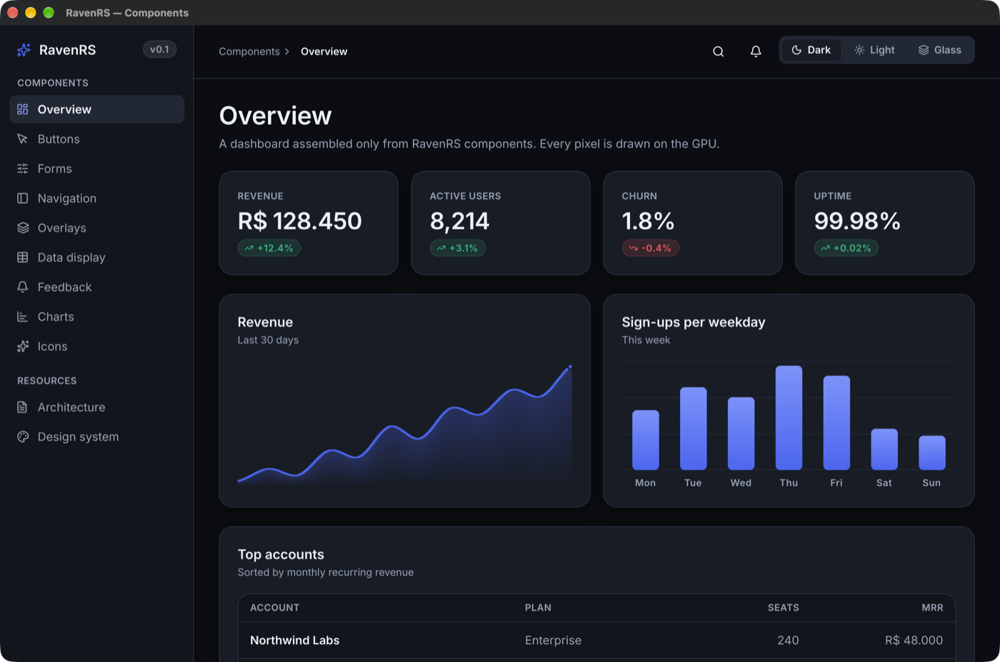

<div align="center">

# RavenRS

**Beautiful native interfaces, powered by Rust.**

Write your UI once, declaratively, and run it in a native window or in the browser.
RavenRS draws every pixel itself on the GPU with `wgpu`: on Windows, macOS and Linux, and through WebAssembly + WebGPU on the web.

[Live demo](https://alexkads.github.io/RavenRS/) · [Architecture](ARCHITECTURE.md) · [Design system](docs/design-system/README.md) · [Roadmap](#roadmap)



</div>

> **Status: early.** The same UI runs natively and in the browser with 40+ components, 112 icons, three themes, reactive state and a GPU renderer. The API will change. See [what is implemented](ARCHITECTURE.md#11-status) and try the [component gallery](https://alexkads.github.io/RavenRS/).

## Why RavenRS

- **One UI, every platform.** The same Rust code renders in a desktop window and on a `<canvas>` in the browser. No DOM widgets, no webview: the renderer is shared, so it looks identical.
- **Declarative and reactive.** Compose views with typed builders. `State<T>` tracks who reads it, so changing a value redraws only when something on screen depends on it.
- **Beautiful by default.** Components read semantic tokens from three themes (Raven Dark, Raven Light, Raven Glass) with contrast checked against WCAG AA in tests.
- **Built to be extended.** Your own components use the same public API as the built-in ones: compose with `Component`, or go low-level with `View` and `BuildCx` for layout, painting, hit-testing and focus.
- **GPU-first, idle when idle.** Signed-distance rounded rectangles, borders, gradients and soft shadows in one shader; text from a glyph atlas. Frames are produced only when something changed.

## A taste

```rust
use raven::prelude::*;

fn app() -> impl View {
    let count = State::new(0);
    let increment = count.clone();

    VStack::new((
        Text::new("Welcome to RavenRS").style(TextStyle::Display),
        Card::new(VStack::new((
            Text::new("REVENUE").style(TextStyle::Caption).foreground(Semantic::InkMuted),
            Text::new("R$ 128.450").style(TextStyle::Metric),
            Text::bound(&count, |n| format!("Clicked {n} times")).foreground(Semantic::InkMuted),
        )))
        .corner_radius(24.0)
        .shadow(Shadow::soft()),
        Button::new("Get Started").on_click(move || increment.update(|n| *n += 1)),
    ))
    .spacing(24.0)
    .padding(32.0)
}

fn main() -> Result<(), raven::native::PlatformError> {
    raven::native::run(app(), raven::native::WindowOptions::new("Hello"))
}
```

### Your own components

```rust
/// State lives in the struct; `body` composes views and runs on every rebuild.
struct Counter {
    count: State<i32>,
}

impl Component for Counter {
    fn body(&self) -> impl View {
        let count = self.count.clone();
        HStack::new((
            Text::bound(&self.count, |c| format!("{c}")).style(TextStyle::Title),
            Button::new("+1").on_click(move || count.update(|c| *c += 1)),
        ))
    }
}
```

Need full control? Implement `View` and use `BuildCx` directly: create layout boxes, paint any `Scene` primitive with `Paint::Custom`, keep per-instance state with `cx.use_state`, open floating layers with `cx.overlay`, react to `cx.is_hovered()` / `cx.is_pressed()`, and register `cx.on_click`, `cx.on_key`, `cx.on_drag`, `cx.focusable` and `cx.cursor`. That is exactly how every built-in component is written. For quick custom drawing there is `Canvas`.

## Components

| Group | Components |
|---|---|
| Inputs | `Button` (primary, secondary, ghost, danger; 3 sizes; icons; disabled), `IconButton`, `TextField`, `Select`, `Toggle`, `Checkbox`, `RadioGroup`, `Slider`, `Stepper`, `SegmentedControl`, `ThemeSwitcher` |
| Navigation | `Tabs`, `Sidebar`, `SidebarSection`, `SidebarItem`, `Breadcrumb`, `Disclosure`, `Accordion` |
| Overlays | `Tooltip`, `Popover`, `DropdownMenu` + `MenuItem`, `Dialog` |
| Layout | `VStack`, `HStack`, `Grid`, `ScrollView`, `Spacer`, `Section`, `Card`, `GlassCard`, and `.padding()`, `.background()`, `.frame()`, `.grow()` on any view |
| Data | `Table`, `List`, `ListItem`, `Stat`, `BarChart`, `AreaChart`, `Canvas` |
| Feedback | `Alert`, `Badge`, `ProgressBar`, `Skeleton` |
| Content | `Text`, `Icon` (112 Lucide icons), `Avatar`, `Kbd`, `Divider` |

All of them are in [`examples/component-gallery`](examples/component-gallery), which runs natively and [in the browser](https://alexkads.github.io/RavenRS/).

## Run it

Requirements: Rust stable (1.88+). For the web: the `wasm32-unknown-unknown` target, `wasm-bindgen-cli` **0.2.130** (it must match the crate version) and, optionally, `wasm-opt` from Binaryen.

**Desktop**

```bash
cargo run -p component-gallery --release
```

```bash
cargo run -p hello-world --release
```

**Browser** (Chrome, Edge, Safari 18+, or Firefox with WebGPU)

```bash
rustup target add wasm32-unknown-unknown
```

```bash
cargo install wasm-bindgen-cli --version 0.2.130 --locked
```

```bash
./scripts/build-web.sh component-gallery
```

```bash
python3 -m http.server -d examples/component-gallery/web 8080
```

Then open http://localhost:8080. Without WebGPU the page explains what is missing instead of failing silently.

**Check everything** (there is no hosted CI; run this before pushing)

```bash
./scripts/check.sh
```

It runs rustfmt, clippy for desktop and wasm32, the test suite and the web build.

**Publish the website**

```bash
./scripts/deploy-pages.sh
```

It builds the landing page and the WebAssembly demo on your machine and pushes them to the `gh-pages` branch that GitHub Pages serves.

The renderer tests draw real scenes on your GPU offscreen and check pixels; they skip themselves on machines without a GPU adapter.

## Crates

| Crate | What it does |
|---|---|
| [`raven`](crates/raven) | The facade and `prelude`. Start here. |
| [`raven-core`](crates/raven-core) | Geometry, colors, input events and `Scene`, the display list between widgets and renderers. |
| [`raven-reactive`](crates/raven-reactive) | `State`, `Binding`, `Derived` and dependency-tracking `Observer`s. Single-threaded, no locks. |
| [`raven-style`](crates/raven-style) | Design tokens and the Raven Dark, Light and Glass themes. |
| [`raven-layout`](crates/raven-layout) | Flexbox layout on [Taffy](https://github.com/DioxusLabs/taffy). |
| [`raven-text`](crates/raven-text) | Text shaping and wrapping with [Parley](https://github.com/linebender/parley), Inter embedded. |
| [`raven-render`](crates/raven-render) | The `wgpu` renderer: SDF quads, shadows, gradients, glyph atlas. |
| [`raven-widgets`](crates/raven-widgets) | `View`, `Component`, `BuildCx`, the built-in widgets and the `Ui` runtime. |
| [`raven-platform-native`](crates/raven-platform-native) | Desktop windows with [winit](https://github.com/rust-windowing/winit). |
| [`raven-platform-web`](crates/raven-platform-web) | `<canvas>` + WebGPU in the browser. |

## Roadmap

1. **Foundation** (done): workspace, local check scripts, wgpu on desktop and WebGPU, SDF shapes, text, first example.
2. **Components** (in progress): 40+ components done; images, `ZStack`, virtualized lists and data grids next.
3. **Reactivity**: incremental reconciliation and per-component invalidation.
4. **Design system**: motion engine (springs, transitions), backdrop blur for Raven Glass, theme switching.
5. **Showcase**: a dashboard and a full component gallery running natively and on the web.
6. **Professional components**: virtualized lists and tables, docking, popovers, menus, command palette, rich text input, accessibility through AccessKit.

## License

Licensed under either of [Apache License 2.0](LICENSE-APACHE) or [MIT](LICENSE-MIT), at your option. The embedded Inter font is under the [SIL Open Font License 1.1](crates/raven-text/fonts/Inter-LICENSE.txt); the icons come from [Lucide](https://lucide.dev) under the [ISC License](crates/raven-text/fonts/RavenIcons-LICENSE.txt).

Contributions are welcome. Unless you state otherwise, any contribution you submit is dual-licensed as above.
