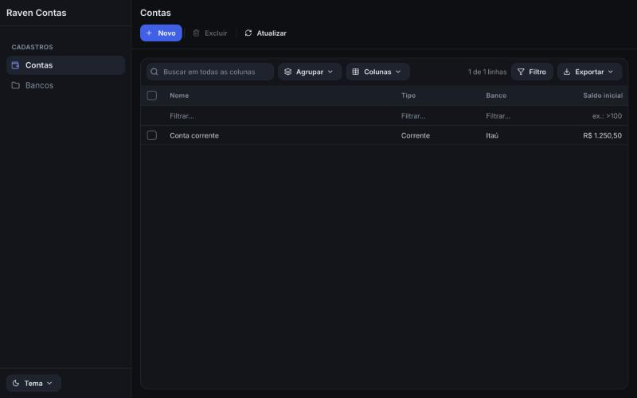

# ravenrs-app

Declare a Rust struct and get a business application: navigation, lists, forms, commands, rules, security and an audit trail. You write only what makes your application different.

**[See one running in your browser](https://alexkads.github.io/RavenRS/quick/)**, generated from two structs:



```rust,ignore
use ravenrs_app::BusinessObject;
use ravenrs_app_ui::App;

#[derive(BusinessObject)]
#[object(caption = "Accounts", navigation = "Records", icon = "wallet")]
#[rule(criteria = "[opening] >= 0", message = "An account cannot open negative")]
struct Account {
    #[field(key)]
    id: i64,
    #[field(caption = "Name", default_property, required)]
    name: String,
    #[field(caption = "Opening balance", money)]
    opening: i64,
}

fn main() -> Result<(), ravenrs::native::PlatformError> {
    let window = App::new("Accounts").entity::<Account>().into_view();
    ravenrs::native::run(window, ravenrs::native::WindowOptions::new("Accounts"))
}
```

That is the whole application: navigation, a list with search, filters and export to Excel, PDF and CSV, a form, and every command from New to Save and close. A wrong attribute is a compile error that points at it.

```bash
cargo add ravenrs ravenrs-app ravenrs-app-ui
```

## What it does

- **Rules and logic.** Validation of every kind, warnings that let people go on, conditional appearance, state machines, reminders, actions and controllers.
- **Security.** Sign-in with lockout, and roles and permissions on entities, records, fields, navigation and actions, enforced in the data layer even with no screen. A full audit trail records who changed what.
- **Data.** SQLite on a schema it manages or on tables you already have, migrations, relations, attachments, and concurrent changes that merge.
- **Views.** Dashboards, charts, trees, calendars and timelines over a list, and reports your users design and keep as records.
- **Customization at run time.** A model in layers, so a module, an administrator or a user can change the application as a JSON difference, and even add fields.

To see all of it, clone the repository and run the feature center, with one small demonstration of each feature:

```bash
cargo run -p feature-center
```

Status: usable today, with the API still moving. Any release before 28.1.0 may hold breaking changes, so pin an exact version.

## The family of crates

| Crate | What it adds |
|---|---|
| `ravenrs-app` | The model, with no GUI: entities, the object space, actions, controllers, rules and security |
| [`ravenrs-app-ui`](https://crates.io/crates/ravenrs-app-ui) | The screens generated from the model |
| [`ravenrs-app-sqlite`](https://crates.io/crates/ravenrs-app-sqlite) | SQLite storage |
| [`ravenrs-app-report`](https://crates.io/crates/ravenrs-app-report) | Reports inside an application |
| [`ravenrs-app-library`](https://crates.io/crates/ravenrs-app-library) | Ready-made people, organizations, addresses, tasks, events, notes and files |

## Inside this crate

- `EntityInfo` describes a record: its fields, what they hold and where they show.
- `generate_model` turns entities into the model's lowest layer. `ModelLayers` puts modules, an administrator and a user on top of it, each as a difference in JSON that can be saved, cleared or moved between versions.
- `ObjectSpace` is a unit of work: changes wait for `commit` or `rollback`. `MemoryDatabase` keeps records in memory, on desktop and in the browser.
- `Action` is something people can do, on or off by reasons, by the view it targets, by what is selected and by criteria over it. `ViewController` and `WindowController` bring actions and react to views, and `Frame` holds a view and turns them on and off in a fixed order.
- `Module` and `Application` put it together, and say what is wrong before any screen opens.

Filters, schemas and calculated fields all speak the language of `ravenrs-criteria`. See the [application framework guide](https://github.com/alexkads/RavenRS/blob/master/docs/APP-FRAMEWORK.md) and what is [done and still missing](https://github.com/alexkads/RavenRS/blob/master/docs/APP-PARITY.md).

Part of [RavenRS](https://github.com/alexkads/RavenRS). Licensed under MIT or Apache-2.0.
