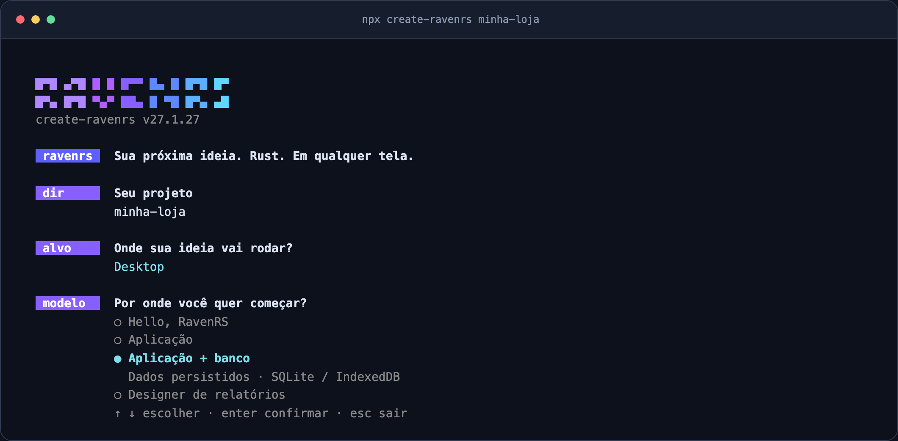

# Getting started with RavenRS

This guide builds a small app step by step: a window, then the same app in the browser, then state, your own components, themes and the data grid.

## Create your project

With Node.js 20 or newer, start with one command:

```bash
npx create-ravenrs minha-loja
```

The guided setup prepares Rust and the matching RavenRS CLI, then asks for a template and
whether to build for desktop, the browser or both. It creates application code, a screen test,
Git and the files your coding assistant needs. You can also use `npm create ravenrs@latest minha-loja`.

For an unattended setup, choose the model and target explicitly:

```bash
npx create-ravenrs minha-loja --yes --template app --target both
cd minha-loja
cargo run
cargo test
cargo ravenrs doctor
```

Without `--yes`, installing Rust, a missing toolchain component or the CLI requires your
confirmation. Existing matching installations are reused. Repeating the command preserves
application code. The first CLI installation compiles Rust sources locally and takes a few minutes.
The setup never runs `sudo`: it prints the Linux packages or Windows MSVC Build Tools you
need to install yourself. Windows requires the C++ workload and Windows SDK even when the
application targets the browser, because the generator itself is a native program.

Already have Rust? Install the CLI directly. Use the release tag to keep the CLI, MCP,
examples, skill and framework crates on the same version:

```bash
cargo install --git https://github.com/alexkads/RavenRS --tag cargo-ravenrs-v27.1.24 --locked cargo-ravenrs
cargo ravenrs new minha-loja --template hello --target both --yes
```

## Choose a template and target

| Template | Starting point | Storage |
| --- | --- | --- |
| `hello` | A card, a counter and buttons | Reactive state |
| `app` | A task list with navigation, forms and commands from `ravenrs-app` | In memory |
| `app-sqlite` | The same task application with persistence | SQLite on desktop; IndexedDB in the browser |
| `relatorios` | The RavenRS report designer | Report layouts |

Use `--target desktop`, `--target web` or `--target both`. The default with `--yes` is
`hello` for `desktop`. The SQLite model requires Rust 1.89 or newer; the bootstrap installs
the stable toolchain for you. Templates and the skill are embedded in the CLI from its release;
they are not fetched from the changing `master` branch.

| Flag | Effect |
| --- | --- |
| `--yes` | Accept prerequisite installations and use defaults for unanswered choices |
| `--no-git` | Skip `git init` |
| `--no-ai` | Skip assistant configuration |
| `--no-check` | Skip the final application compilation; keep the MCP handshake |
| `--plugin` | Use the version-pinned Claude marketplace plugin instead of a copied local skill |

## Your project structure

```text
minha-loja/
├── Cargo.toml              # published crate versions, no checkout paths
├── rust-toolchain.toml
├── src/
│   ├── main.rs             # native window
│   └── lib.rs              # app() and the shared UI
├── tests/screen.rs         # main-screen render test
├── web/index.html          # when web or both is selected
├── AGENTS.md               # commands and project rules
└── CLAUDE.md               # points to AGENTS.md
```

Start changing `app()` in `src/lib.rs`. The desktop entry point opens that view in a
native window. A web target includes its browser entry point and HTML canvas. Run
`cargo test` to check that the main screen still renders.

## Work with a coding assistant

The generator registers the same offline MCP server for Claude Code (`.mcp.json`),
VS Code / Copilot (`.vscode/mcp.json`), Cursor (`.cursor/mcp.json`) and Codex
(`.codex/config.toml`). Every configuration launches `cargo ravenrs mcp`.

Open the folder with `claude`, `code .` or your preferred assistant. The project includes
the version-matched RavenRS skill and `AGENTS.md` commands. The instructions tell the
assistant to consult `component_api` and `component_examples` before inventing a method,
use design tokens and existing components, and build record applications with `ravenrs-app`.
Claude settings allow the project's Cargo commands and read-only RavenRS MCP tools.
Your editor may still require its normal workspace trust approval.

For a project that already exists, run:

```bash
cargo ravenrs ai
cargo ravenrs doctor
```

After updating framework versions, install the matching CLI tag and run `ai` again.
It updates marked blocks and RavenRS configuration entries, preserving custom instructions
outside those blocks. Keep personal notes outside the generated markers. It does not migrate
application source. Use `cargo ravenrs ai --plugin` for the marketplace mode.

`doctor` checks explicit dependency versions, generated AI files and real MCP handshakes.
It exits with an error when a version or configuration is stale. With the npm entry point,
`npx create-ravenrs doctor` also checks prerequisites and never installs anything.
Workspace-inherited dependency versions are tracked separately in
[issue #209](https://github.com/alexkads/RavenRS/issues/209).

## Run in the browser

Choose `web` or `both` when creating the app. In the generated project:

```bash
cargo check --target wasm32-unknown-unknown
cargo build --release --lib --target wasm32-unknown-unknown
cargo install wasm-bindgen-cli --version 0.2.130 --locked
wasm-bindgen --target web --out-dir web/pkg target/wasm32-unknown-unknown/release/minha_loja.wasm
python3 -m http.server -d web 8080
```

Open `http://localhost:8080`. Replace `minha_loja` with your package name, using underscores
for hyphens. `wasm-bindgen-cli` must match the framework's pinned `wasm-bindgen` version.
Serve the page over HTTP rather than opening the HTML file directly.

## Understand the pieces

The following walkthrough shows how to build these pieces yourself: a window, browser entry
point, state, components, themes and a data grid. For the CLI's behavior and validation details,
see [cargo-ravenrs](../crates/cargo-ravenrs/README.md) and
[create-ravenrs](../npm/create-ravenrs/README.md).

## 1. A window

```bash
cargo new hello-raven && cd hello-raven
```

```bash
cargo add ravenrs
```

```rust
// src/main.rs
use ravenrs::prelude::*;

fn app() -> impl View {
    VStack::new((
        Text::new("Hello, RavenRS").style(TextStyle::Display),
        Text::new("Drawn on the GPU.").foreground(Semantic::InkMuted),
    ))
    .padding(32.0)
}

fn main() -> Result<(), ravenrs::native::PlatformError> {
    ravenrs::native::run(app(), ravenrs::native::WindowOptions::new("Hello").size(800.0, 500.0))
}
```

```bash
cargo run
```

## 2. The same app in the browser

Put the UI in `src/lib.rs` so both targets share it, and add a web entry point:

```toml
[lib]
crate-type = ["cdylib", "rlib"]

[target.'cfg(target_arch = "wasm32")'.dependencies]
wasm-bindgen = "=0.2.130"
wasm-bindgen-futures = "0.4"
```

```rust
// src/lib.rs
use ravenrs::prelude::*;

pub fn app() -> impl View {
    Text::new("Hello from the browser").style(TextStyle::Display).padding(32.0)
}

#[cfg(target_arch = "wasm32")]
#[wasm_bindgen::prelude::wasm_bindgen(start)]
pub fn start() {
    wasm_bindgen_futures::spawn_local(async {
        // Keep the returned app alive for as long as the page shows it.
        if let Ok(app) = ravenrs::web::start(app(), ravenrs::web::WebOptions::new("raven-canvas")).await {
            std::mem::forget(app);
        }
    });
}
```

A page with a `<canvas id="raven-canvas">` sized by CSS hosts it; [`examples/hello-world/web/index.html`](../examples/hello-world/web/index.html) is a complete one, and [`scripts/build-web.sh`](../scripts/build-web.sh) shows the build (`cargo build --target wasm32-unknown-unknown` followed by `wasm-bindgen --target web`).

## 3. State

`State<T>` holds a value. Views that read it rebuild when it changes; nothing else does.

```rust
let count = State::new(0);
let inc = count.clone();
VStack::new((
    Text::bound(&count, |n| format!("{n} clicks")),
    Button::new("Click").on_click(move || inc.update(|n| *n += 1)),
))
```

Controls take a `Binding<T>`, a read/write view of a state: `Toggle::new(enabled.binding())`, `TextField::new(name.binding())`, `Slider::new(volume.binding())`. `Binding::map` focuses on one field of a struct, and `Derived<T>` caches a value computed from other states.

## 4. Your own components

A `Component` keeps its state in fields and composes views in `body`:

```rust
struct Counter { count: State<i32> }

impl Component for Counter {
    fn body(&self) -> impl View {
        let c = self.count.clone();
        Button::new("Add").on_click(move || c.update(|n| *n += 1))
    }
}
```

For full control, implement `View` and use `BuildCx`. This badge draws itself, reacts to hover and handles clicks:

```rust
struct Pill(&'static str);

impl View for Pill {
    fn build(&self, cx: &mut BuildCx<'_>) -> NodeId {
        let theme = *cx.theme();
        let fill = if cx.is_hovered() { theme.color(Semantic::Accent) } else { theme.color(Semantic::Control) };
        let label = cx.child(&Text::new(self.0));
        let node = cx.container(
            ravenrs::layout::LayoutStyle { padding: (6.0, 12.0).into(), ..Default::default() },
            &[label],
            Paint::Quad(QuadPaint { corner_radius: 999.0, ..QuadPaint::new(fill) }),
        );
        cx.on_click(node, std::rc::Rc::new(|| println!("clicked")));
        cx.cursor(node, CursorIcon::Pointer);
        node
    }
}
```

`cx.use_state` gives a view instance its own state (open/closed, scroll position), `cx.overlay` opens a floating layer, `cx.wake_at` schedules a rebuild (animations, timers) and `cx.shortcut` registers app-wide keys.

## 5. Themes

Pick a theme when you start the app, or switch at runtime:

```rust
ravenrs::native::run(app(), ravenrs::native::WindowOptions::new("App").theme(Theme::raven_light()))
```

`ThemeSwitcher::new()` toggles Raven Dark, Light and Glass, or the app's own three with `.themes(dark, light, glass)`, `ThemePicker` does it from a small menu, and `ThemeEditor` changes the tokens of the theme on screen and hands them over as JSON (`Theme::to_tokens_json`, `Theme::from_tokens_json`); any component can do the same with `cx.theme_state().set(...)`. Components use semantic roles (`Semantic::Ink`, `Semantic::Accent`, `Semantic::SurfaceElevated`…) so they follow the theme automatically. The tokens are documented in [docs/design-system](design-system/README.md).

## 6. The data grid

```rust
use ravenrs::widgets::grid::Value;

let data = GridData::new(vec![
    vec![Value::from("Northwind"), Value::from("Brazil"), Value::from(240)],
    vec![Value::from("Aurora"), Value::from("Chile"), Value::from(86)],
]);

DataGrid::new(data, [
    GridColumn::text("Customer").editable(),
    GridColumn::text("Country"),
    GridColumn::number("Seats").summary(Summary::Sum),
])
.selection_mode(SelectionMode::Multiple)
.height(480.0)
```

Sorting, the filter row (`>100`, `10..20`, `yes`, or an expression such as `[Seats] > 10 And [Country] = 'Brazil'`), search, grouping, resizing, the column chooser, editing and CSV export work out of the box; only the visible rows are built, so 100,000+ rows stay smooth.

## 7. Quality checks

`ravenrs-lint` checks what the compiler cannot: colors from `Semantic` roles, text from `TextStyle`, the 4px grid, named icon buttons, one primary action, and no state or blocking work in `body`. Set it up once and it fails the build of anyone, person or coding agent, who breaks a rule:

```bash
cargo install ravenrs-lint --locked
cargo ravenrs-lint --init --language en   # or pt-BR
cargo ravenrs-lint --gate
```

`--init` turns on the strictest rustc and Clippy levels, adds a test so `cargo test` runs the rules, and writes the same instructions for Codex, Claude, Gemini and Copilot. See [its README](../crates/ravenrs-lint/README.md) for every rule.

## Next

- Browse every component in the [live gallery](https://alexkads.github.io/RavenRS/) and its [source](../examples/component-gallery/src/lib.rs).
- Install [Raven Finanças](../examples/family-finance), a complete family finance app built with RavenRS, to see it all in everyday use.
- Read the [architecture](../ARCHITECTURE.md) to see how build, layout, paint and render fit together.
- The [API documentation](https://alexkads.github.io/RavenRS/api/ravenrs/) lists every type and method.

## Official context for AI assistants

Read the [AI development guide](AI_DEVELOPMENT.md) for the RavenRS proposal, official Markdown sources,
version-matched MCP tools and a starting prompt. The site publishes `llms.txt` and `llms-full.txt`
from these same guides so assistants can consult authoritative context.

## Interactive installation



The npm preparer asks for your target and template before starting, with arrow-key selection
and descriptions. During installation, animated tasks show elapsed time and current build activity.
Full Cargo/Git output is saved to a temporary installation log; a failing task prints its last output
and the log path. Use `npx create-ravenrs minha-loja --verbose` to stream all output.

Escape cancels a menu; Ctrl+C cancels an active task. `NO_COLOR` disables colors. Redirected output
and simple terminals show plain logs; narrow terminals use text prompts. `--yes` still authorizes
prerequisite installation and selects defaults for unanswered choices.

## Repeating creation in an existing folder

Repeating creation preserves application source only when the original template and target match.
A desktop project cannot be turned into a web project, or a hello project into an application, by
reusing its folder in the creator. Choose another folder for a different template or target.
The creator reports incompatible choices before installing prerequisites or changing files.
