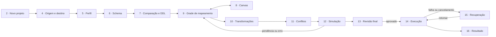
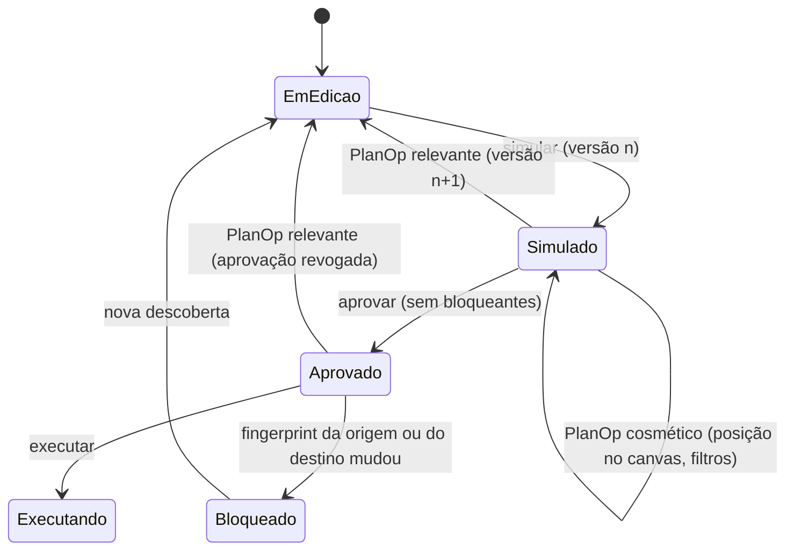
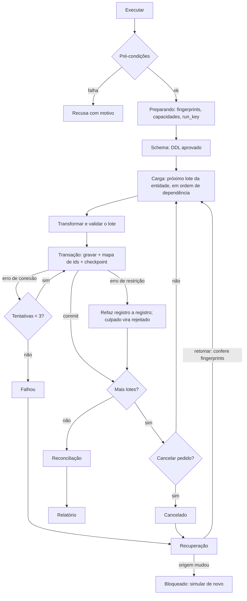

# Raven Data Studio: fluxos

Os quatro fluxos abaixo mostram o mesmo plano por caminhos diferentes. A numeração das telas é a de [06-telas.md](06-telas.md).

## 1. Fluxo guiado (assistente)



- O `StepIndicator` mostra cada etapa como `Done`, `Current`, `Upcoming` ou `Error`. Uma etapa está `Done` quando o domínio não aponta nenhum problema bloqueante nela. Isso não depende de o usuário ter clicado em Avançar.
- O usuário pode pular para qualquer etapa já alcançada. Etapas posteriores à primeira com `Error` ficam acessíveis, mas o indicador mostra o motivo.
- O canvas (8) e a grade (9) são a mesma etapa, "Mapeamento", vista de dois jeitos.

### Exemplo do cenário

| Etapa | O que acontece | Pendências que saem dela |
|---|---|---|
| 4 | Marca CLIENTES e PEDIDOS; destino `loja`. | — |
| 5 | Perfil acha CPF com pontuação (806), CEP sem zero (211), 37 CPFs repetidos e o vínculo inferido de 99,7%. | Aceitar o vínculo |
| 6 | Propõe Alterar `customers`, Criar `customer_addresses` e `orders`, e uma estrutura Intermediária para a mescla. | — |
| 9 | 22 campos; a IA sugere os mapeamentos; `orders.status` com valor `X` sem correspondência. | C10 |
| 10 | Regras com antes e depois; 23 endereços sem divisão segura; 9 CPFs inválidos. | C3, C9 (não bloqueantes) |
| 11 | Upsert por `document`; mescla com sobrevivente mais antigo. | C1 (confirmar o sobrevivente) |
| 12 | Conta fecha: 8.031 gravações, 83 fora. | — |
| 13 | C1 e C10 resolvidas; aprovado. | — |

## 2. Fluxo por conversa

```mermaid
sequenceDiagram
  actor U as Usuário
  participant C as Conversa (Chat)
  participant A as Agente (ravenrs-ai)
  participant D as Domínio
  participant V as Vistas (grade, canvas)
  U->>C: "Separe também o bairro do endereço de entrega"
  C->>D: monta PlanContext (resumo, foco, política do que pode sair)
  D->>A: PlanRequest + PlanContext
  A-->>D: PlanProposal (PlanPatch + confiança + perguntas)
  D->>D: valida patch (tipos, exemplos na amostra, capacidades)
  alt patch válido
    D-->>C: card de proposta (operações, antes/depois, contagens)
    U->>C: Aceitar (todas ou uma a uma)
    C->>D: aplica → PlanVersion n+1
    D-->>V: plano atualizado; simulação marcada como desatualizada
  else patch recusado
    D-->>A: erro estruturado (até 2 novas tentativas)
    D-->>C: "Não consegui: <motivo>" + sugestão de editar na grade
  end
```

- A conversa nunca muda o plano sozinha: o card de proposta é o único caminho, e cada operação tem Aceitar e Recusar.
- "Por quê?" sobre um item chama `Planner::explain`. A resposta cita ids do plano, e clicar num id leva ao item.
- A conversa é guardada pelo módulo junto com o projeto. O modelo não guarda histórico, e o contexto é montado de novo a cada pedido.

## 3. Invalidação depois de uma mudança



O que o usuário vê quando uma mudança relevante acontece depois da simulação:

1. A `StatusBar` troca "Simulação v7 · válida" por "Simulação v7 · desatualizada (plano v8)".
2. A tela de Simulação mostra o `Alert` de aviso e os números em cinza com a palavra "desatualizado".
3. Se havia aprovação, a Revisão final mostra "Aprovação revogada pela versão 8 (autor, resumo)" e Aprovar volta a exigir nova simulação.
4. Um evento de auditoria registra a revogação.

A tabela completa do que é relevante ou cosmético está em [09-modelo-de-dominio.md](09-modelo-de-dominio.md#invalidação).

## 4. Execução e retomada



### Exemplo de retomada no cenário

1. A execução grava `customers` (2 lotes: 1.000 + 202) e `customer_addresses` (2 lotes: 1.000 + 568).
2. Em `orders`, o lote 4 (registros 3.001 a 4.000 pela ordem de `NUM_PED`) falha por queda de conexão. Depois de 3 tentativas, o job fica `Falhou`.
3. A Recuperação mostra os lotes 1 a 3 de `orders` como `Committed` e o lote 4 como `Failed`, com o checkpoint no fim do lote 3.
4. Retomar confere os fingerprints, relê a partir do cursor do lote 3 e grava os lotes 4 a 6. Os pedidos do lote 4 que porventura chegaram ao destino antes da queda são atualizados sem mudança, porque o upsert é por `legacy_id`.
5. O resultado final é igual ao de uma execução sem falha: 5.261 pedidos, nenhum duplicado.
