# Raven Data Studio: wireframes

Os desenhos abaixo são **estáticos e de baixa fidelidade**: mostram disposição, conteúdo e estados com os números do [cenário](cenario-de-referencia.md). O desenho de alta fidelidade, com o design system do RavenRS (tema Raven Dark), está no Claude Design: [Raven Data Studio](https://claude.ai/artifact/QT6Fc1Mp5CSJrXRK4VLM9g). Ele traz as telas 2, 8, 9, 12, 14 e 16 e a página de Interações, e aguarda aprovação antes de qualquer implementação (decisão D-09).

Os arquivos SVG usam tokens neutros e acompanham o tema claro ou escuro do sistema (`prefers-color-scheme`). Os números em círculo são chamadas explicadas abaixo de cada imagem.

## Novo projeto por intenção (tela 2)

1. A proposta chega como card na conversa (`ChatMessage::card`). O que foi entendido aparece em linhas, com contagens e a base de cada número.
2. Cada pendência vira `PendingDecision`. As que bloqueiam usam o ícone de aviso, e as informativas usam o ícone de informação.
3. Nada é criado antes de Aceitar. "Parar" fica fora do `Chat` até existir `Chat::on_stop` (E-7).

## Grade de mapeamento (tela 9)

1. Linha selecionada (`orders.status`), com o estado "1 pendência" em texto e ícone.
2. Inspetor (`MappingInspector`, M-3) com a tabela de valores e as contagens por valor. As contagens somam 5.312 = 660 + 4.281 + 365 + 6.
3. Lista persistente de problemas (`IssueList`, N-3). Nenhum desses avisos aparece só como toast.

A `StatusBar` mostra a versão do plano e diz que a simulação está desatualizada.

## Canvas (tela 8)

1. A pendência é desenhada com tracejado laranja **e** com o rótulo no nó de regra ("23 em revisão", "1 pendência"). Ela não depende da cor.

Origem à esquerda, destino à direita, nós de regra no meio. O minimapa e o zoom são os do `FlowCanvas`. Mover nós não invalida a simulação.

## Simulação (tela 12)

1. O cabeçalho diz o **tipo** de simulação, a cobertura e para qual versão do plano ela vale, e explica o que ela não garante.
2. A conta de chegada fecha por entidade: 1.248 = 1.202 + 37 + 9; 5.312 = 5.261 + 14 + 6 + 31; 1.591 − 23 = 1.568.

## Execução (tela 14)

1. Uma linha por entidade com progresso, contagens, lote atual e total **estimado** ("≈6").
2. Cancelar explica o efeito (o lote atual termina e os lotes gravados ficam) e não promete desfazer.

## Resultado (tela 16)

1. A aba Rejeitados mostra o registro como veio da origem (`45,00`, `16/03/2024`). A exportação "Rejeitados (CSV fiel)" é diferente de "Grade atual".

## Interações passo a passo

Cada gesto é descrito em quatro passos, e cada um traz as regras de ponteiro, teclado, leitor de tela e histórico.

| Gesto | Ponteiro | Teclado | Leitor de tela | Histórico |
|---|---|---|---|---|
| I1 Ligar campo no canvas | Arrastar de porta a porta; as compatíveis acendem | Enter no campo, setas escolhem o destino, Enter confirma, Esc cancela (E-1) | "CPF para document; regra Só dígitos sugerida" | 1 `PlanPatch` (`SetFieldMapping`) |
| I2 Recusa de ligação | Porta vermelha e motivo junto ao cursor; soltar não muda nada | Destino incompatível não entra na lista | "Não aceito: texto de data não vira telefone" | Nada |
| I3 Aceitar sugestão da IA | Aceitar/Recusar por operação | Tab entre itens, Espaço marca, Enter aplica | "4 aceitas, 1 recusada; plano versão 8" | 1 `PlanPatch` com as operações aceitas |
| I4 Testar regra | Editar no inspetor; a grade mostra antes → depois | F2 edita, Cmd/Ctrl+Enter testa | "200 afetados, 0 erros" | 1 `PlanPatch` ao confirmar |
| I5 Desfazer | Menu Editar › Desfazer | Cmd/Ctrl+Z, Shift+Cmd/Ctrl+Z | "Desfeito: tipo de total" | Pilha de patches da sessão. A simulação da versão restaurada volta a valer. |
| I6 Cancelar execução | Botão e `ConfirmDialog` | Esc **não** cancela execução; só o botão | Anúncio assertivo "Execução cancelada" | Evento de auditoria |

**Janela estreita (< 900 px).** A `Sidebar` vira gaveta e o canvas sai: a grade passa a ser a única vista de mapeamento. Inspetor e conversa abrem como `Sheet`.

**Mapa de teclado.**

| Tecla | Ação |
|---|---|
| Cmd/Ctrl+K | Paleta de comandos |
| F6 / Shift+F6 | Próxima / anterior região |
| Cmd/Ctrl+Z, Shift+Cmd/Ctrl+Z | Desfazer / refazer patch |
| Cmd/Ctrl+Enter | Ação principal da tela |
| F8 / Shift+F8 | Próximo / anterior problema |
| F7 / Shift+F7 | Próximo / anterior trecho da diferença (N-2) |
| `+` `-` `0` | Zoom do canvas |
| Shift+F10 | Menu de contexto (E-5) |
