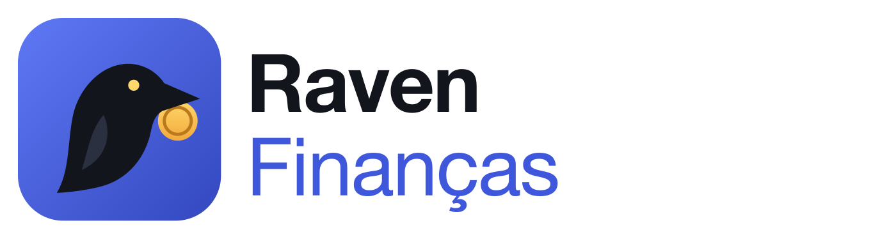

A desktop app for a family's expenses and bills to pay, with its data in one SQLite file on the computer. It has two jobs: to show what RavenRS can do in a real app, and to find what RavenRS is still missing. When a component falls short, the fix goes into the framework, not here.

```bash
cargo run -p family-finance
```

The first run opens on a sample family, so there is something to explore. **Ajustes → Começar do zero** clears it for real use. The database is `~/.raven-financas/financas.db`, or the path given as the first argument.

## What each screen uses

| Screen | RavenRS |
|---|---|
| Painel | `Stat`, `Alert`, `AreaChart`, `BarChart`, `Grid`, `List`, `responsive` |
| Lançamentos | `DataGrid` (filter row, search, grouping, totals, cell templates, CSV), `SegmentedControl`, `DropdownMenu`, `ravenrs-criteria` |
| Contas a pagar | `DataGrid`, `Dialog`, `FormField`, `DatePicker`, `Select`, `Stepper` |
| Agenda | `Scheduler` to move what is ahead, `EventCalendar` for the month, `RecurrenceEditor` to plan a receipt or a payment |
| Orçamentos | `ProgressBar`, `Alert`, `Dialog` |
| Relatórios | `ravenrs-report`, `ravenrs-report-viewer`, `ravenrs-report-export`, charts and barcodes from `ravenrs-graphics` |
| Cadastros | `Tabs`, `ListItem`, `FormField` |
| Ajustes | `ThemeSwitcher` |
| Exports and backup | `ravenrs::native::SaveDialog`, `open_with_system` |
| Treinamentos and reporting a problem | `ravenrs::movie`: `MoviePlayer` with films recorded by `tests/training.rs`, `FlightRecorder`, `BugReporter` |
| Updates | `StatusBar`, `ReleaseNotes`, `CodeBlock`, and `UiWaker`, which wakes the UI when a background thread finishes |
| Everywhere | `Sidebar`, `CommandPalette` (⌘K), `Toaster`, `Tooltip`, `Localized` |

The filter on Lançamentos is the part to read first. What the user types, such as `[Valor] > 100 And [Categoria] = 'Mercado'`, is checked against a schema and translated by `ravenrs-criteria` into SQL with bound parameters, so typed text can never change the query ([src/filter.rs](src/filter.rs)).

## How the code is laid out

| Path | What it holds |
|---|---|
| `src/db.rs` | Schema, migrations and every query. Money is whole cents; writes that touch several rows run in one transaction |
| `src/model.rs`, `src/money.rs` | The records and the rules that need no database |
| `src/filter.rs` | Expressions to SQL |
| `src/reports.rs` | The report definitions |
| `src/update.rs` | Finding and installing a new version |
| `schedules` and `schedule_days` tables | What is planned: the days come from a `RecurrenceRule`, and only days confirmed, moved or skipped get a row |
| `assets/` | The logo and the icon: `icon.svg` is the source, and the others are made from it |
| `src/ui/` | One file per screen; `store.rs` has what they share |
| `tests/db.rs`, `tests/app.rs` | The rules on a real database, and the app driven through `Ui`, without a window |
| `tests/screens.rs` | Draws every screen to a PNG file |

```bash
FF_SCREENSHOTS=$PWD/target/screens cargo test -p family-finance --test screens
```

## Installing and updating

The app is not packaged. It installs and updates by compiling the master branch on the user's machine, the way VintageLightbox does, using `install.cmd`, one file that runs on all three systems. It gets what it needs first, Rust and a C compiler, so the first run can take a while; updates reuse what was compiled. It asks for an administrator's permission only to install those tools.

**Windows 11**, in PowerShell, or download [install.cmd](install.cmd) and double-click it:

```powershell
irm https://raw.githubusercontent.com/alexkads/RavenRS/master/examples/family-finance/install.cmd -OutFile "$env:TEMP\install.cmd"; & "$env:TEMP\install.cmd"
```

**macOS and Linux**, in a terminal:

```bash
curl -fsSL https://raw.githubusercontent.com/alexkads/RavenRS/master/examples/family-finance/install.cmd -o /tmp/install.cmd && sh /tmp/install.cmd
```

| System | What it gets | Where the app goes | How to open it |
|---|---|---|---|
| Windows 11 | Visual Studio Build Tools by `winget`, Rust | `%LOCALAPPDATA%\Programs\RavenFinancas` | Start menu |
| macOS | Apple's command line tools, Rust | `/Applications/Raven Finanças.app`, or `~/Applications` without permission there | Launchpad or Finder |
| Linux | C compiler and window libraries by `apt`, `dnf`, `pacman` or `zypper`, Rust | `~/.local/bin/family-finance` | Applications menu |

When it opens and every hour after that, the app reads `novidades.json` from master, silently. If that version is newer, the line at the foot of the window says so and an installed copy starts compiling at low priority, telling each step the installer announces. **Procurar atualização**, in Ajustes, answers there even when there is nothing new. The same line always shows the version in use, and clicking it shows what that version brought. The installed app is only replaced after the new binary answers `--versao`, and the old one is kept: on macOS in `~/.raven-financas/anterior`, elsewhere beside it as `.anterior`. A version that failed is not retried by itself for a day. A copy built with `cargo run` only mentions the new version.

**If the app is slow**, press Ctrl+Shift+D (Cmd+Shift+D on a Mac) to see which GPU it is on and what its frames cost, or run `family-finance --diagnostico` for the GPU report in the terminal, which also works when the window will not open. Both give text to paste into a bug report, and the panel's **Relatar bug** button opens a new GitHub issue with that text in the browser, for you to review and send.

The training film is `assets/treinamentos.ravenmovie`, recorded from the app itself, about 300 KB. After screens change, a test fails if the script no longer fits, and `FF_RECORD_TRAINING=1 cargo test -p family-finance --test training` records it again.

**To release**, make one commit with three changes: `version` in `Cargo.toml`, `novidades.json`, and the same entry with its `data` on top of `historico-de-novidades.json`. A test holds them together. Make it the last commit of the release: anyone who compiled 0.1.N will not compile another 0.1.N.

Updates come over HTTPS from this repository, with no signature of their own.

## What this example found in RavenRS

Fixed in the framework:

* Controls ignored `Align::Center` in their stack (`Align::Fit`).
* `None` and other empty views took a gap in their stack.
* `DocumentViewer` assumed it had the whole window.
* A doughnut chart's legend listed categories with no slice.
* Component text was fixed in English (`Labels`, `Localized`).
* `Stat` could not show spending going up as bad (`Stat::delta_toned`).
* There was no way to show or edit things over time (`Scheduler`, `EventCalendar`, `RecurrenceEditor`).
* A menu inside a dialog opened in the window's corner, behind the backdrop.
* Nothing let a background thread ask for a frame (`UiWaker`).
* The desktop had no save dialog (`ravenrs::native::SaveDialog`).
* Each app repeated how to open a file with the system's program (`ravenrs::native::open_with_system`).

Still open:

* **The rest of the scheduler.** What is missing from the reference product is listed in [docs/PARITY.md](../../docs/PARITY.md).
* **Chart axes.** `AreaChart` has no axis labels or tooltips, so the dashboard writes the first and last month by hand.
* **More text to translate.** `Ribbon`, `Carousel`, `InputOtp`, `validate::email`, `validate::min_length` and a grid's yes/no values are still in English.

Missing in the app itself: transfers between accounts, so a credit card's balance has no way to be paid off, and the chosen theme is not remembered.
