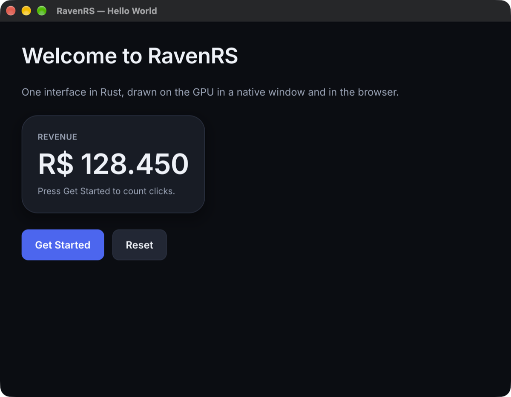
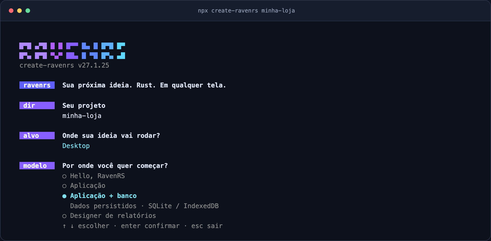

# create-ravenrs

[](https://www.npmjs.com/package/create-ravenrs)
[](https://nodejs.org/)
[](https://github.com/alexkads/RavenRS#license)

**Create a Rust GUI application for desktop and the browser with one command.**

`create-ravenrs` prepares Rust, generates a [RavenRS](https://github.com/alexkads/RavenRS)
project and configures your coding assistant with the API, examples, skill and MCP server
from the same framework release.

```bash
npx create-ravenrs minha-loja
```

[Documentation](https://alexkads.github.io/RavenRS/docs/) ·
[Getting started](https://alexkads.github.io/RavenRS/docs/getting-started/) ·
[Live component gallery](https://alexkads.github.io/RavenRS/demo/) ·
[GitHub](https://github.com/alexkads/RavenRS) ·
[Report an issue](https://github.com/alexkads/RavenRS/issues)



## What is RavenRS?

RavenRS is an open-source GUI framework for Rust. Build one declarative interface for
**Windows, macOS, Linux and WebAssembly**, rendered on the GPU with `wgpu`. The browser
backend supports WebGPU and a WebGL2 fallback.

The framework combines reusable UI components, reactive state, layout, design tokens,
accessibility, record applications built from metadata, and report design and rendering.
Start with a small interface or generate navigation, record lists and forms with `ravenrs-app`.

This npm package is the **project creator and environment bootstrapper**. Your generated
application is a Cargo project written in Rust. The npm launcher uses Node.js built-ins
and has **zero runtime npm dependencies**.

## Quick start

You need **Node.js 20 or newer**. Rust can be installed by the guided setup.

```bash
npx create-ravenrs minha-loja
cd minha-loja
cargo run
```

You can also use npm's create syntax:

```bash
npm create ravenrs@latest minha-loja
```

The setup asks for a template and a target. To choose both up front:

```bash
npx create-ravenrs minha-loja --template app --target both
```

For an unattended setup, `--yes` authorizes prerequisite installations and selects defaults
for unanswered choices:

```bash
npx create-ravenrs minha-loja --yes --template app --target both
```

The default is the `hello` template for `desktop`. The first CLI installation compiles Rust
sources locally and can take a few minutes. Repeating the same command preserves your
application source and reuses already matching prerequisites.

## An installation you can follow



The interactive terminal offers arrow-key menus with template descriptions, a RavenRS wordmark,
and animated progress with elapsed time and the current build activity. Choose the target and
template before installation starts. Press Escape in a menu or Ctrl+C to cancel.

Successful builds keep Cargo and Git output in a complete local log instead of flooding the
terminal. If a process fails, the error includes its last output and the log path. To stream
every command output while troubleshooting:

```bash
npx create-ravenrs minha-loja --verbose
```

Redirected output and simple terminals use readable plain logs. `NO_COLOR` disables colors.
Narrow or short terminals use text prompts. No runtime npm dependencies are required.

## What the command does

1. **Rust:** detects `rustc`, Cargo and rustup; offers the official Rust installer when needed.
2. **Toolchain:** prepares the template's toolchain, rustfmt and Clippy, plus the WASM target when selected.
3. **RavenRS CLI:** installs the pinned `cargo-ravenrs` release from its public Git tag.
4. **System libraries:** checks native dependencies and prints platform-specific installation instructions.
5. **Your project:** generates Rust code, a screen test, Git and version-matched assistant configuration.
6. **Doctor:** checks versions, assistant files and actual MCP handshakes.

Installations require confirmation unless you pass `--yes`. The bootstrap does not run `sudo`
or install system packages or MSVC Build Tools. It shows what to install, then you can rerun it.
Rust is downloaded from the official `static.rust-lang.org` distribution; the CLI comes from
the public [RavenRS repository](https://github.com/alexkads/RavenRS).

## Templates

| `--template` | What you start with | Storage |
| --- | --- | --- |
| `hello` | A card, a click counter and buttons | Reactive state |
| `app` | A task application with navigation, lists, forms and commands | In memory |
| `app-sqlite` | The task application with persistence | SQLite on desktop; IndexedDB in the browser |
| `relatorios` | The RavenRS report designer | Report layouts |

The SQLite model requires Rust 1.89 or newer. The bootstrap prepares the stable toolchain.

| `--target` | Result |
| --- | --- |
| `desktop` | A native application for your current operating system |
| `web` | A browser application built to WebAssembly |
| `both` | Shared Rust UI with native and browser entry points |

## What gets generated

```text
minha-loja/
├── Cargo.toml                  # published RavenRS dependency versions
├── rust-toolchain.toml
├── src/
│   ├── main.rs                 # native entry point
│   └── lib.rs                  # shared app() and browser entry point
├── tests/screen.rs             # main-screen render test
├── web/index.html              # for web / both
├── .mcp.json                   # Claude Code MCP
├── .vscode/mcp.json             # VS Code / GitHub Copilot MCP
├── .cursor/mcp.json             # Cursor MCP
├── .codex/config.toml           # Codex MCP
├── .claude/skills/ravenrs/      # version-matched RavenRS skill
├── AGENTS.md                   # project commands and rules
├── CLAUDE.md                   # points to AGENTS.md
└── .gitignore
```

Start changing `app()` in `src/lib.rs`. Run `cargo test` to exercise the screen test and
`cargo ravenrs doctor` to validate the assistant integration.

## Build with AI coding assistants

The project registers **`cargo ravenrs mcp`** for Claude Code, VS Code / GitHub Copilot,
Cursor and Codex. The embedded MCP server answers from the framework sources and docs
of the pinned release, and works offline after installation.

It lets your assistant:

- Inspect real component APIs and examples with `component_api` and `component_examples`.
- Look up semantic design tokens with `design_tokens`.
- Check feature coverage before promising a component exists.
- Validate expressions and create or check report layouts.

The copied skill and project instructions explain how to compose RavenRS views, use existing
components and design tokens, and use `ravenrs-app` for record applications. Claude settings
allow the project's Cargo commands and read-only RavenRS MCP tools. Your editor can still
require its normal workspace trust approval.

Open the generated folder in your assistant:

```bash
cd minha-loja
claude
# or: code .
```

Use `--plugin` for the version-pinned Claude marketplace plugin instead of the local skill copy.
For an existing Rust project, install the matching CLI and run `cargo ravenrs ai`.

[AI development guide](https://alexkads.github.io/RavenRS/docs/ai/) ·
[CLI reference](https://alexkads.github.io/RavenRS/docs/cli/)

## Command reference

```text
npx create-ravenrs <name> [options]
npx create-ravenrs doctor
npx create-ravenrs --help
npx create-ravenrs --version
```

| Option | Behavior |
| --- | --- |
| `--verbose` | Stream complete subprocess output instead of the animated task view |
| `--template <name>` | `hello`, `app`, `app-sqlite` or `relatorios` |
| `--target <target>` | `desktop`, `web` or `both` |
| `--yes`, `-y` | Authorize prerequisite installations and use defaults for unanswered choices |
| `--no-git` | Skip `git init` |
| `--no-ai` | Skip assistant configuration |
| `--no-check` | Skip application compilation; keep the MCP handshake |
| `--plugin` | Use the Claude marketplace plugin instead of copying the local skill |
| `--help`, `-h` | Show usage |
| `--version`, `-V` | Show the npm launcher and pinned framework versions |

The included Rust CLI provides:

| Command | Purpose |
| --- | --- |
| `cargo ravenrs new <name>` | Generate a project directly |
| `cargo ravenrs ai` | Create or update managed assistant configuration |
| `cargo ravenrs mcp` | Serve the version-matched MCP tools over stdio |
| `cargo ravenrs doctor` | Check framework versions, assistant files and MCP connections |

## Build for the web

Create a project with `--target web` or `--target both`, then build its library:

```bash
cargo check --target wasm32-unknown-unknown
cargo build --release --lib --target wasm32-unknown-unknown
cargo install wasm-bindgen-cli --version 0.2.130 --locked
wasm-bindgen --target web --out-dir web/pkg target/wasm32-unknown-unknown/release/minha_loja.wasm
python3 -m http.server -d web 8080
```

Open `http://localhost:8080`. Replace `minha_loja` with your package name, replacing hyphens
with underscores. The wasm-bindgen CLI version must match the framework's pinned version.
See the generated README and [browser guide](https://alexkads.github.io/RavenRS/docs/getting-started/#run-in-the-browser).

## Check an installation

From the generated project:

```bash
npx create-ravenrs doctor
```

Doctor is read-only: it never installs, downloads or prompts, even with `--yes`.
It checks prerequisites and invokes the Rust CLI's doctor for project and MCP validation.

| Problem | What to do |
| --- | --- |
| Permission is required in a noninteractive terminal | Pass `--yes` only when you want to authorize prerequisite installations |
| Linux libraries are missing | Run the distribution-specific command printed by the bootstrap, then rerun |
| Windows linker / Build Tools are missing | Install [MSVC Build Tools](https://visualstudio.microsoft.com/visual-cpp-build-tools/) with the C++ workload and Windows SDK |
| CLI and project versions differ | Install the CLI tag that matches your project's RavenRS dependencies |
| Assistant files are stale | Run `cargo ravenrs ai`, then `cargo ravenrs doctor` |
| A project directory already exists | Generated projects from the same framework version are preserved; unrelated directories are rejected |

Native Linux libraries are skipped for web-only applications. Windows needs MSVC even for
web projects because the CLI itself is native. The CLI requires a rustup-managed toolchain.

## Release compatibility

The npm launcher can receive documentation and bootstrap patches independently of the Rust
framework. Its `release.json` pins the exact CLI Git tag and framework version used for generation.
**`create-ravenrs` 27.1.25 installs `cargo-ravenrs` / RavenRS 27.1.23.**

```bash
cargo install --git https://github.com/alexkads/RavenRS --tag v27.1.23 --locked cargo-ravenrs
```

Templates, skill and MCP all come from that Rust release. npm-only updates do not silently
change the framework API or migrate your application source. Prebuilt platform binaries are
not included yet; the CLI is compiled on the first installation.

## Learn more and contribute

- [Documentation on GitHub Pages](https://alexkads.github.io/RavenRS/docs/)
- [Documentation on Vercel](https://ravenrs.vercel.app/docs/)
- [Start your first app](https://alexkads.github.io/RavenRS/docs/getting-started/)
- [Explore the live components](https://alexkads.github.io/RavenRS/demo/)
- [Use the report designer](https://alexkads.github.io/RavenRS/designer/)
- [Read the source or contribute](https://github.com/alexkads/RavenRS)
- [Report a bug or request a feature](https://github.com/alexkads/RavenRS/issues)

Include your operating system, Node.js version, `npx create-ravenrs --version` output and the
error message when reporting a problem. Do not include tokens or other credentials.

For AI tools, the site also provides [llms.txt](https://alexkads.github.io/RavenRS/llms.txt)
and [the complete Markdown documentation](https://alexkads.github.io/RavenRS/llms-full.txt).

## License

RavenRS and this launcher are dual-licensed under **MIT OR Apache-2.0**.
